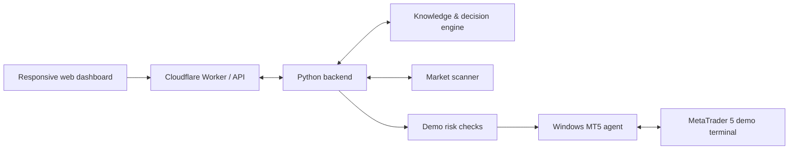

# MONEY GIRL
### AI-assisted market analysis and demo trading automation platform

**Project type:** Fintech · Full-stack development · Systems integration · Applied AI  
**Status:** Ongoing development and demo testing  
**Public release:** Architecture and case study only (private operational code and credentials are not included)

## Overview

MONEY GIRL is a multi-component application intended to analyse financial markets, ingest trading knowledge, generate explainable trading signals, and support controlled **demo-account** execution through MetaTrader 5 (MT5). The application combines a browser-based dashboard, a Python backend, Windows-based MT5 connectivity, and cloud-hosted services.

The project demonstrates engineering work in systems integration, backend services, REST APIs, frontend interfaces, automated workflows, operational monitoring, and risk-aware financial software.

## System architecture

This is a **conceptual architecture** rather than a claim that every component is presently operational.

## Engineering areas

| Area | Technical focus |
|---|---|
| Frontend | Responsive UI, market dashboards, symbol selection, controls, and status indicators |
| Backend | Python services, API endpoints, scanner orchestration, and system health checks |
| Market integration | MetaTrader 5 connectivity and multi-symbol market data |
| Knowledge workflows | PDF/text training ingestion and rules-based decision support |
| Risk management | Account-type checks, demo gating, position sizing, and safety controls |
| Cloud | Cloudflare Workers and services for a remotely accessible interface |
| Operations | Windows VPS hosting, watchdog processes, observability, and recovery workflows |
| Delivery | Version control and deployment workflows using GitHub |

## Key engineering challenges

- Coordinating cloud services with a Windows-hosted trading terminal.
- Distinguishing service connectivity from actual trading readiness.
- Designing traceable signals with reasons and risk checks.
- Handling broker order rejection and account-specific execution constraints.
- Preserving historical knowledge and operational data during deployments.
- Building monitoring interfaces that remain useful on desktop and mobile.

## My contributions

This case study showcases work across the project's design and iterative development, including the responsive interface, system architecture, API integrations, workflow planning, feature testing, and troubleshooting. Individual contributions and production-readiness claims should be validated before using this description in a formal employment application.

## Technologies

`Python` · `JavaScript` · `HTML` · `CSS` · `REST APIs` · `MetaTrader 5` · `Cloudflare Workers` · `GitHub` · `Windows Server / VPS`

## Safety and disclosures

- The public repository contains **no** live trading credentials, API keys, MT5 account details, proprietary rules, or operational source code.
- All execution demonstrations should use **demo accounts** and controlled testing.
- This repository does not provide investment advice or claim consistent profitability.
- The platform remains an evolving project; not all planned features are complete or verified.

## Contact / Portfolio

[SaintLaurentEnoch on GitHub](https://github.com/SaintLaurentEnoch) · [LinkedIn](https://www.linkedin.com/in/enocha52)
